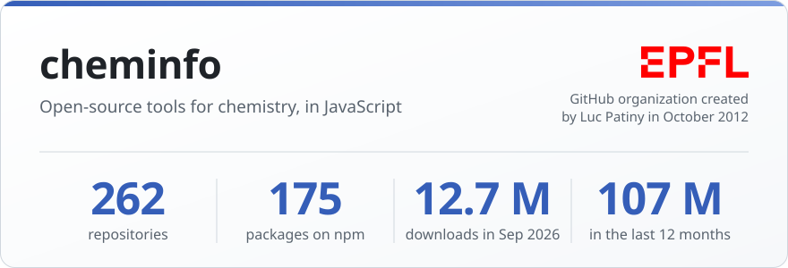
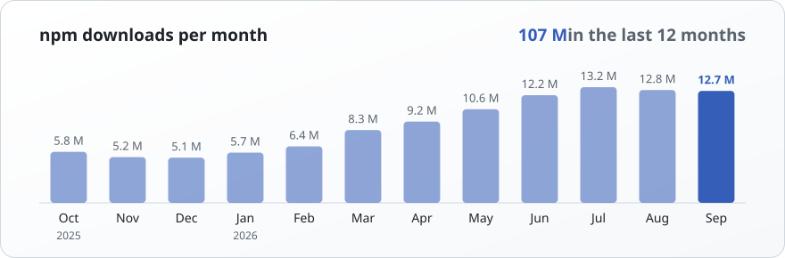

<picture>
  <source media="(prefers-color-scheme: dark)" srcset="stats-dark.svg">
  
</picture>

The **cheminfo** organization on GitHub was created in October 2012 in the group of [Luc Patiny](https://github.com/lpatiny) at [EPFL](https://www.epfl.ch). It gathers open-source JavaScript and TypeScript tools for chemistry, for the browser and Node.js: parsers and converters for analytical data (NMR, mass spectrometry, IR, Raman, UV-vis, XPS, chromatography and more), molecular formulas and structures with [OpenChemLib JS](https://github.com/cheminfo/openchemlib-js), and web applications such as [NMRium](https://github.com/cheminfo/nmrium).

It contains **262 public repositories** and **175 packages published on npm**, downloaded **12,730,147 times in September 2026** and **107,387,150 times in the last 12 months** (October 2025 to September 2026). Many of these packages are currently maintained by [Zakodium Sàrl](https://www.zakodium.com).

<picture>
  <source media="(prefers-color-scheme: dark)" srcset="downloads-dark.svg">
  
</picture>

### Most downloaded in September 2026

| | Package | Sep 2026 | 12 months | |
|--:|---|--:|--:|---|
| 1 | [is-any-array](https://www.npmjs.com/package/is-any-array) | 8,346,492 | 71,487,700 | Check if a value is any kind of array |
| 2 | [cheminfo-types](https://www.npmjs.com/package/cheminfo-types) | 3,289,569 | 26,201,094 | Types for cheminfo packages and cheminfo data schema |
| 3 | [netcdfjs](https://www.npmjs.com/package/netcdfjs) | 311,222 | 3,432,012 | Read and explore NetCDF files |
| 4 | [mrz](https://www.npmjs.com/package/mrz) | 214,612 | 1,164,672 | Parse MRZ (Machine Readable Zone) from identity documents |
| 5 | [openchemlib](https://www.npmjs.com/package/openchemlib) | 123,830 | 687,931 | Manipulate molecules |
| 6 | [uint8-base64](https://www.npmjs.com/package/uint8-base64) | 97,761 | 761,011 | Encode and decode base64 to and from Uint8Array |
| 7 | [dynamic-typing](https://www.npmjs.com/package/dynamic-typing) | 35,588 | 280,695 | Dynamically type a string |
| 8 | [eslint-config-cheminfo](https://www.npmjs.com/package/eslint-config-cheminfo) | 32,678 | 347,462 | Shared ESLint config for cheminfo and ml.js projects |
| 9 | [ensure-string](https://www.npmjs.com/package/ensure-string) | 30,589 | 276,769 | Ensure that we receive a text even if an ArrayBuffer is sent |
| 10 | [sdf-parser](https://www.npmjs.com/package/sdf-parser) | 28,670 | 221,749 | SDF parser |

### Sister organizations

<table>
<tr>
<td width="50%">

<b><a href="https://github.com/mljs">ml.js</a></b> 
Machine learning and numerical analysis in JavaScript 
107 npm packages, 431 million downloads in the last 12 months
</td>
<td width="50%">

<b><a href="https://github.com/image-js">image-js</a></b> 
Image processing and analysis in JavaScript 
13 npm packages, 684 million downloads in the last 12 months
</td>
</tr>
</table>

Updated on 2026-10-29 from the GitHub and npm APIs. Repositories are the public ones of [cheminfo](https://github.com/cheminfo), forks excluded. Downloads are those reported by npm for whole calendar months.
