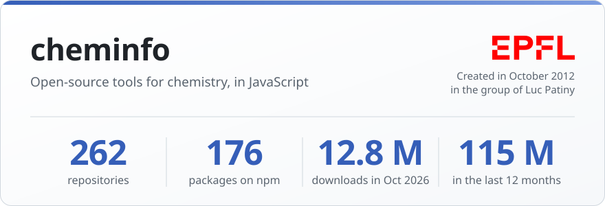
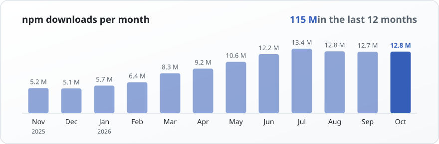

<picture>
  <source media="(prefers-color-scheme: dark)" srcset="stats-dark.svg">
  
</picture>

The **cheminfo** organization on GitHub was created in October 2012 in the group of [Luc Patiny](https://github.com/lpatiny) at [EPFL](https://www.epfl.ch). It gathers open-source JavaScript and TypeScript tools for chemistry, for the browser and Node.js: parsers and converters for analytical data (NMR, mass spectrometry, IR, Raman, UV-vis, XPS, chromatography and more), molecular formulas and structures with [OpenChemLib JS](https://github.com/cheminfo/openchemlib-js), and web applications such as [NMRium](https://github.com/cheminfo/nmrium).

It contains **262 public repositories** and **176 packages published on npm**, downloaded **12,761,197 times in October 2026** and **114,569,372 times in the last 12 months** (November 2025 to October 2026). Many of these packages are currently maintained by [Zakodium Sàrl](https://www.zakodium.com).

<picture>
  <source media="(prefers-color-scheme: dark)" srcset="downloads-dark.svg">
  
</picture>

### Most downloaded in October 2026

| | Package | Oct 2026 | 12 months | |
|--:|---|--:|--:|---|
| 1 | [is-any-array](https://www.npmjs.com/package/is-any-array) | 8,245,417 | 75,515,091 | Check if a value is any kind of array |
| 2 | [cheminfo-types](https://www.npmjs.com/package/cheminfo-types) | 3,222,829 | 28,385,363 | Types for cheminfo packages and cheminfo data schema |
| 3 | [netcdfjs](https://www.npmjs.com/package/netcdfjs) | 381,611 | 3,795,637 | Read and explore NetCDF files |
| 4 | [mrz](https://www.npmjs.com/package/mrz) | 265,128 | 1,393,773 | Parse MRZ (Machine Readable Zone) from identity documents |
| 5 | [openchemlib](https://www.npmjs.com/package/openchemlib) | 138,598 | 803,181 | Manipulate molecules |
| 6 | [uint8-base64](https://www.npmjs.com/package/uint8-base64) | 88,059 | 832,173 | Encode and decode base64 to and from Uint8Array |
| 7 | [dynamic-typing](https://www.npmjs.com/package/dynamic-typing) | 42,516 | 311,738 | Dynamically type a string |
| 8 | [ensure-string](https://www.npmjs.com/package/ensure-string) | 40,243 | 305,668 | Ensure that we receive a text even if an ArrayBuffer is sent |
| 9 | [sdf-parser](https://www.npmjs.com/package/sdf-parser) | 36,457 | 247,140 | SDF parser |
| 10 | [eslint-config-cheminfo](https://www.npmjs.com/package/eslint-config-cheminfo) | 31,038 | 356,276 | Shared ESLint config for cheminfo and ml.js projects |

### Sister organizations

<table>
<tr>
<td width="50%">

<b><a href="https://github.com/mljs">ml.js</a></b> 
Machine learning and numerical analysis in JavaScript 
118 npm packages, 452 million downloads in the last 12 months
</td>
<td width="50%">

<b><a href="https://github.com/image-js">image-js</a></b> 
Image processing and analysis in JavaScript 
13 npm packages, 786 million downloads in the last 12 months
</td>
</tr>
</table>

Updated on 2026-11-03 from the GitHub and npm APIs. Repositories are the public ones of [cheminfo](https://github.com/cheminfo), forks excluded. Downloads are those reported by npm for whole calendar months.
